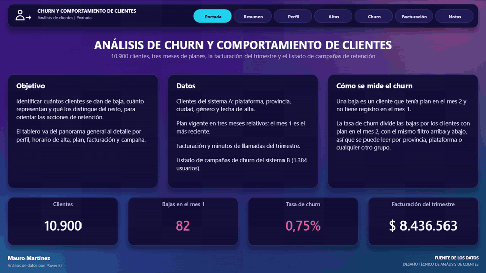
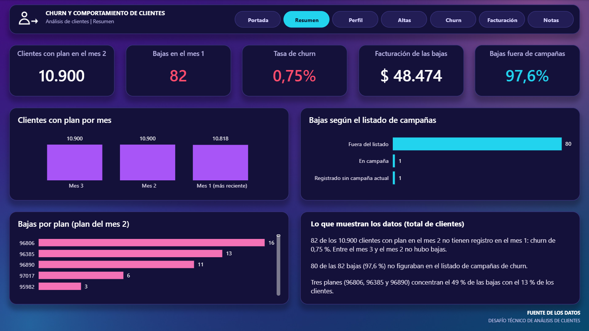
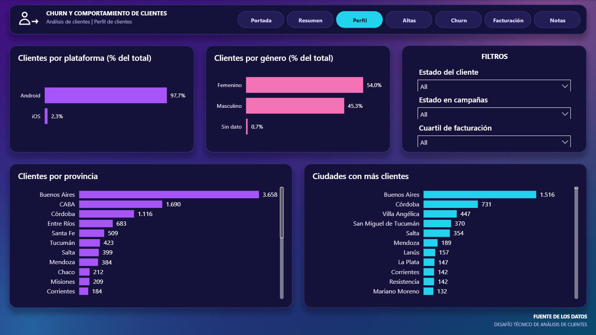
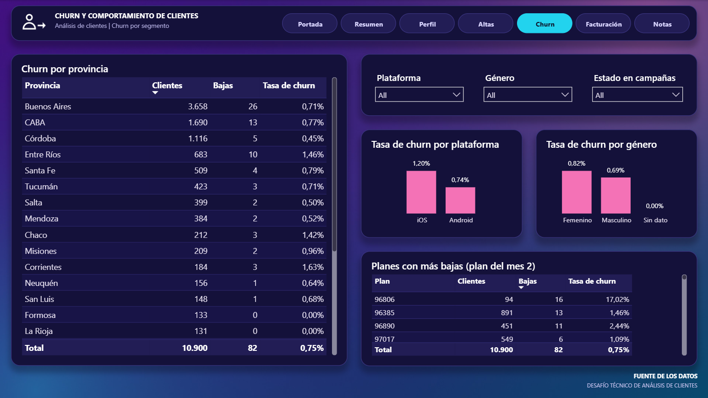
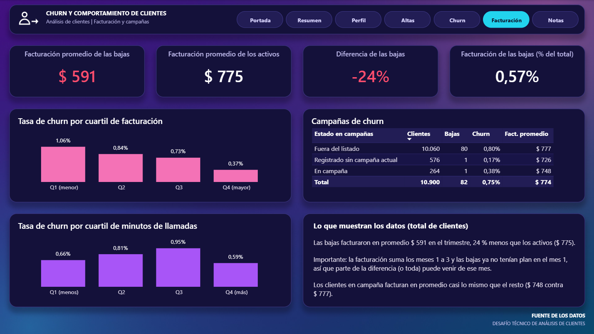
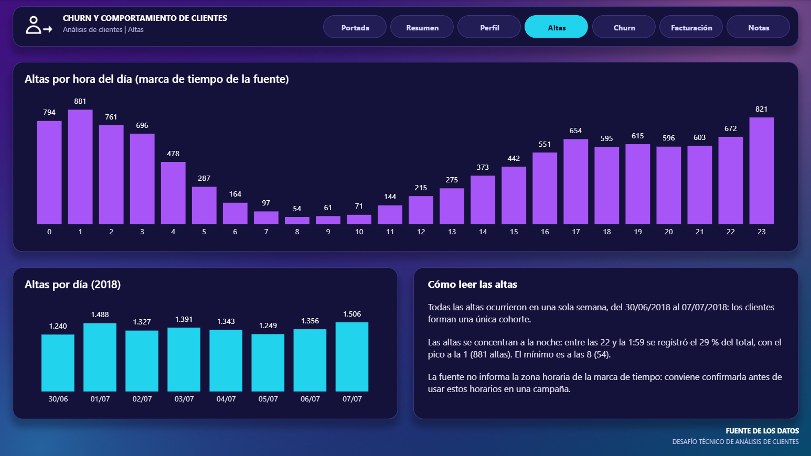
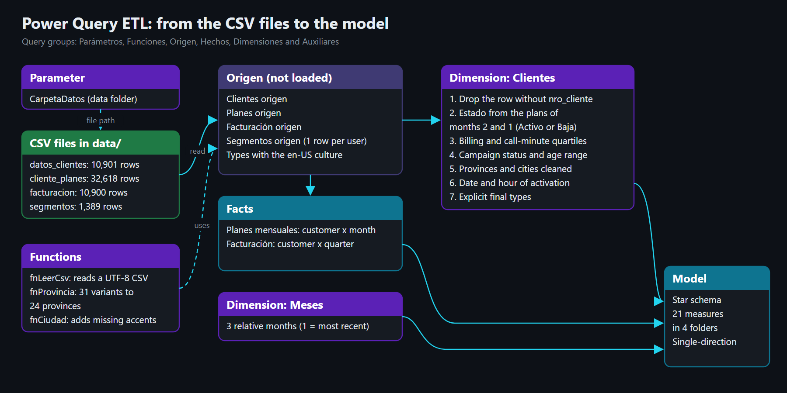
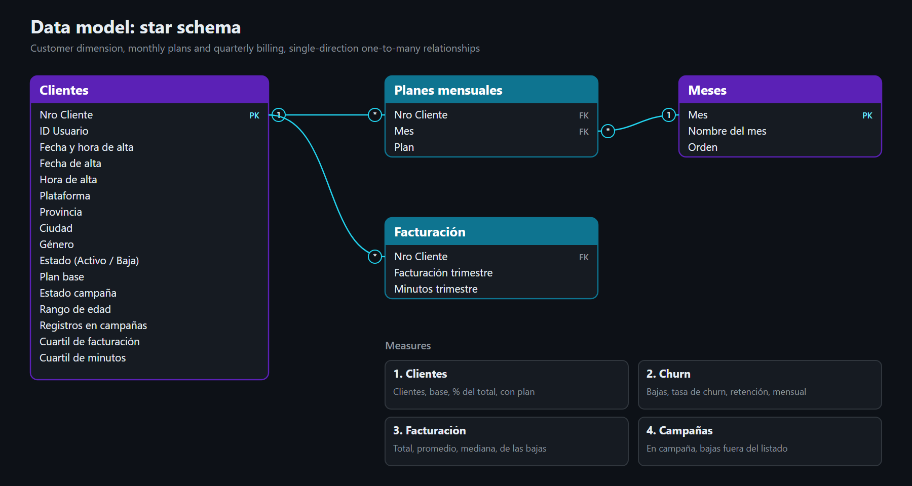

# 📉 Análisis de churn y comportamiento de clientes
<p>
  <a href="README.md"></a>
  <a href="README.es.md"></a>
</p>

## 📽️ Vista previa del dashboard
<p align="center">
  
</p>

<p align="center"><a href="docs/Preview.mp4">▶️ Ver el recorrido en calidad completa (MP4)</a></p>

> El dashboard está en español.
> El repositorio incluye el reporte como archivo **.pbix** común y como **Power BI Project (PBIP)**, así que el modelo de datos, las medidas DAX y el código de Power Query se pueden leer directamente acá en GitHub.

**Stack:**    

## 📋 Resumen ejecutivo
Un análisis de la retención de clientes de un servicio con **10.900 clientes**: quiénes son, cuándo se dieron de alta, qué plan tenían cada mes, cuánto se les facturó en el trimestre y si formaban parte de una campaña de churn.

Los datos provienen de cuatro archivos CSV (clientes, planes mensuales, facturación y minutos de llamadas del trimestre, y el listado de la campaña de churn) más un diccionario de datos.

**Cómo se mide el churn.** Un cliente cuenta como baja cuando tenía plan en el mes 2 y no tiene registro de plan en el mes 1, el mes más reciente. La tasa de churn divide las bajas por los clientes con plan en el mes 2, con los mismos filtros en ambos términos, así que se puede leer para cualquier grupo. La fuente no dice por qué falta un registro de plan: una baja puede ser una cancelación, una suspensión o un registro faltante.

## 📈 Hallazgos principales

| Indicador | Valor |
|---|---:|
| Clientes con plan en el mes 2 | 10.900 |
| Bajas en el mes 1 | **82** |
| Tasa de churn | **0,75%** |
| Bajas entre el mes 3 y el mes 2 | 0 |
| Facturación trimestral de las bajas | $48.474 (0,57% de $8,44 M) |

- **Las campañas de churn no llegaron a los clientes que se fueron:** 80 de las 82 bajas (97,6%) no estaban en el listado de campaña. Los clientes en una campaña vigente tienen, en promedio, una facturación parecida a la de los clientes fuera del listado ($748 vs. $777).
- **Tres planes concentran casi la mitad del churn:** el plan 96806 perdió 16 de sus 94 clientes (17%). Junto con los planes 96385 (13 de 891) y 96890 (11 de 451) explica el 49% de las bajas con el 13% de la base de clientes.
- **Menor facturación, con una salvedad:** a las bajas se les facturó en promedio $591 en el trimestre, un 24% menos que a los clientes activos ($775), y el churn baja del 1,06% en el cuartil de facturación más bajo al 0,37% en el más alto. La facturación cubre los meses 1 a 3 y las bajas no tenían plan en el mes 1, así que parte de esa diferencia, o toda, puede deberse al mes faltante. Los minutos de llamadas no muestran un patrón claro.
- **Perfil:** Android representa el 97,7% de los clientes; las mujeres, el 54,0% y los hombres, el 45,3%. La provincia de Buenos Aires, CABA y Córdoba concentran el 59% de la base. Las diferencias por plataforma, género o provincia se apoyan en muy pocos casos (por ejemplo, 3 bajas de iOS sobre 249 clientes) y no son concluyentes.
- **Altas:** todos los clientes se dieron de alta en una sola semana, del 30 de junio al 7 de julio de 2018. Las altas tienen su pico de noche: el 29% entre las 22:00 y las 01:59, con el máximo a la 1:00 (881). La zona horaria de la marca de tiempo no está documentada.

Son resultados observados sobre tres meses de datos. El dashboard enumera hipótesis a validar (criterios de las campañas, los tres planes, facturación mensual), que acá no se ponen a prueba.

## 🖥️ Páginas del dashboard

<table>
  <tr>
    <td width="50%"><br><b>Resumen</b>: KPI principales, clientes con plan por mes, churn por plan y por estado de campaña.</td>
    <td width="50%"><br><b>Perfil de clientes</b>: plataforma, género, provincias y ciudades, con filtros por estado, estado de campaña y cuartil de facturación.</td>
  </tr>
  <tr>
    <td width="50%"><br><b>Churn</b>: churn por provincia (clientes, bajas y tasa), plataforma, género y plan.</td>
    <td width="50%"><br><b>Facturación y campañas</b>: facturación de bajas vs. activos, churn por cuartil de facturación y de minutos de llamadas, tabla de campañas.</td>
  </tr>
  <tr>
    <td width="50%"><br><b>Altas</b>: altas por hora del día y por día.</td>
    <td width="50%">El reporte también tiene una portada con el objetivo, los datos y la definición de churn, y una página de notas con definiciones, observaciones sobre la calidad de los datos e hipótesis a validar.</td>
  </tr>
</table>

## 🔄 Preparación de datos (Power Query)

<p align="center">
  
</p>

Las consultas están agrupadas en carpetas:

| Carpeta | Consultas | Para qué sirven |
|---|---|---|
| Parámetros | `CarpetaDatos` | Ubicación de los archivos CSV. Cambiala después de clonar. |
| Funciones | `fnLeerCsv`, `fnProvincia`, `fnCiudad` | Leer un CSV en UTF-8; unificar los nombres de provincia (31 grafías en 24 provincias); agregar las tildes que faltan en los nombres de ciudad. Documentadas con descripciones y ejemplos. |
| Origen | `Clientes origen`, `Planes origen`, `Facturación origen`, `Segmentos origen` | Una consulta por CSV con tipos explícitos, sin cargar al modelo. Los tipos usan la cultura en-US porque los decimales vienen con punto. |
| Hechos | `Planes mensuales`, `Facturación` | Plan por cliente y por mes; facturación y minutos de llamadas trimestrales por cliente. |
| Dimensiones | `Clientes`, `Meses` | Una fila por cliente con estado, cuartiles y datos de campaña; los tres meses relativos. |
| Auxiliares | `Medidas` | Contenedor de medidas. |

**`Clientes` paso a paso**
1. Descarta la fila de origen sin `nro_cliente` (no se puede vincular con planes ni con facturación).
2. Agrega el plan del mes 2 y el estado: `Baja` cuando hay plan en el mes 2 y no hay registro de plan en el mes 1, `Activo` en los demás casos.
3. Agrega los cuartiles de facturación y de minutos de llamadas: los clientes se ordenan por valor y se dividen en cuatro grupos del mismo tamaño.
4. Agrega el estado de campaña y el rango de edad desde el listado de campaña (unidos por `user_id`).
5. Limpia las provincias con `fnProvincia` y las ciudades con `fnCiudad`; traduce el género.
6. Agrega la fecha y la hora del alta.
7. Define tipos finales explícitos para cada columna cargada.

El estado sale de una combinación con los clientes que tienen plan en el mes 1, en lugar de una búsqueda fila por fila:

```powerquery
ClientesMes1 = Table.AddColumn(Table.SelectColumns(Table.SelectRows(Planes, each [mes] = 1), {"nro_cliente"}), "Con plan en el mes 1", each true, type logical),
ConMes1 = Table.ExpandTableColumn(Table.NestedJoin(ConPlanBase, {"nro_cliente"}, ClientesMes1, {"nro_cliente"}, "M1", JoinKind.LeftOuter), "M1", {"Con plan en el mes 1"}),
Estado = Table.AddColumn(ConMes1, "Estado", each if [Plan base] = null then "Sin plan en el mes 2" else if [Con plan en el mes 1] = true then "Activo" else "Baja", type text)
```

**Controles de calidad de datos**

| Control | Resultado |
|---|---|
| Clientes cargados | 10.900 (queda afuera una fila de origen sin `nro_cliente`) |
| Clientes con plan en los meses 3, 2 y 1 | 10.900, 10.900 y 10.818 |
| Filas de facturación que coinciden con un cliente | 10.900 de 10.900 |
| Usuarios del listado de campaña que coinciden con un cliente | 840 de 1.384 |
| Provincias | 31 grafías unificadas en 24 |
| Valores de `user_id` | Algunos llegan dañados por una planilla de cálculo (ceros a la izquierda perdidos, notación científica como `4.11E+08`); dos clientes comparten un mismo valor dañado |

## 🏗️ Modelo de datos
Esquema en estrella: la dimensión `Clientes` filtra las dos tablas de hechos, y `Meses` filtra los planes mensuales. Todas las relaciones son de uno a varios, con filtro en una sola dirección.

<p align="center">
  
</p>

### Medidas

| Carpeta | Medidas |
|---|---|
| 1. Clientes | `Clientes`, `Clientes base`, `% del total de clientes`, `Clientes con plan` |
| 2. Churn | `Bajas`, `Tasa de churn`, `Tasa de retención`, `Bajas en el mes`, `Tasa de churn mensual` |
| 3. Facturación | `Facturación`, `Facturación promedio`, `Facturación mediana`, `Minutos promedio`, `Facturación de las bajas`, `% de la facturación en bajas`, `Facturación promedio de las bajas`, `Facturación promedio de los activos`, `Diferencia de facturación de las bajas` |
| 4. Campañas | `Clientes en campaña`, `Bajas fuera del listado`, `% de bajas fuera del listado` |

El numerador y el denominador comparten el mismo contexto de filtro, así que la tasa es correcta para cualquier provincia, plataforma, plan o grupo de campaña, y un grupo con clientes pero sin bajas muestra 0% en lugar de quedar en blanco:

```dax
Clientes base = CALCULATE ( [Clientes], Clientes[Estado] IN { "Activo", "Baja" } )

Bajas =
IF ( NOT ISBLANK ( [Clientes base] ), CALCULATE ( [Clientes], Clientes[Estado] = "Baja" ) + 0 )

Tasa de churn = DIVIDE ( [Bajas], [Clientes base] )
```

Cada tabla, columna, medida y paso de Power Query se puede revisar en [`Churn_Clientes.SemanticModel/definition`](Churn_Clientes.SemanticModel/definition) (formato TMDL).

## ⚠️ Alcance y limitaciones
- **Tres meses relativos:** los planes no tienen fechas de calendario y el mes 1 es el más reciente. Una sola caída entre dos meses no alcanza para mostrar una tendencia.
- **Qué es una baja:** un registro de plan faltante. Los datos no dicen si se trata de una cancelación, una suspensión o un registro faltante.
- **Facturación trimestral:** la facturación y los minutos de llamadas son totales de los meses 1 a 3, así que, en el caso de las bajas, incluyen un mes sin plan.
- **Grupos chicos:** las tasas de los grupos con pocos clientes son inestables (Tierra del Fuego: 2 bajas sobre 47). Conviene leerlas junto con la cantidad de bajas.

## 📂 Estructura del repositorio

```
├── Churn_Clientes.pbix                        # el dashboard en un solo archivo, con los datos incluidos
├── Churn_Clientes.pbip                        # el mismo dashboard como Power BI Project (código fuente)
├── Churn_Clientes.SemanticModel/definition/   # modelo de datos como código (TMDL): tablas, medidas, Power Query
├── Churn_Clientes.Report/definition/          # reporte como código (PBIR): una carpeta por página y por visual
├── data/                                      # archivos CSV de origen y el diccionario de datos
├── Preview.gif                                # recorrido por el dashboard (incrustado arriba)
├── docs/Preview.mp4                           # recorrido en calidad completa
├── docs/img/                                  # imágenes del README: páginas, flujo ETL y modelo de datos
└── LICENSE
```

## ▶️ Cómo abrirlo

| | `Churn_Clientes.pbix` | `Churn_Clientes.pbip` |
|---|---|---|
| Qué es | Un único archivo de Power BI | Un Power BI Project: el modelo (TMDL) y el reporte (PBIR) como archivos de texto |
| Datos | Incluidos, listos para explorar | Se cargan desde los archivos CSV de `/data` al actualizar |
| Ideal para | Abrir el dashboard enseguida | Revisar el código DAX y de Power Query, control de versiones |

**Opción 1: solo verlo.** Descargá `Churn_Clientes.pbix` y abrilo con Power BI Desktop.

**Opción 2: trabajar con el código fuente.**
1. Cloná el repositorio (o descargalo como ZIP).
2. Abrí `Churn_Clientes.pbip` con una versión reciente de Power BI Desktop.
3. Andá a **Inicio > Transformar datos > Editar parámetros** y poné en `CarpetaDatos` la ruta completa de la carpeta `data` en tu computadora (terminada en `\`).
4. Hacé clic en **Actualizar**.

Los dos archivos contienen el mismo reporte.

## 👤 Autor
**Mauro Martínez**.

Los archivos del proyecto se publican bajo la [licencia MIT](LICENSE). Los datos siguen sujetos a los términos de su fuente.
