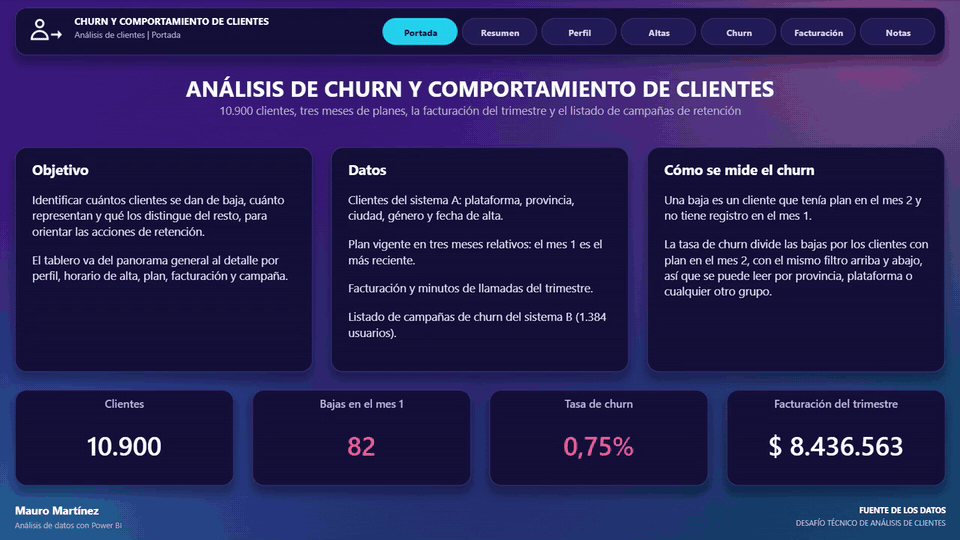
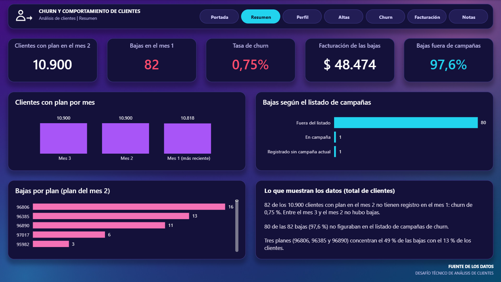
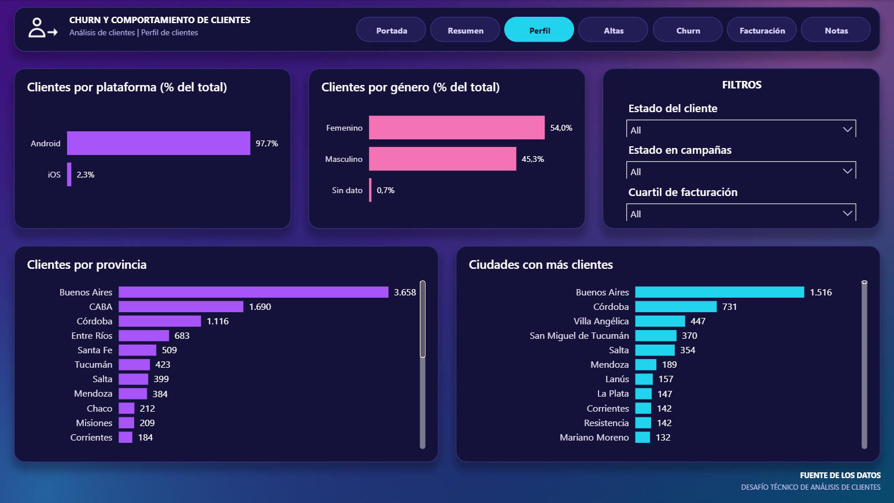
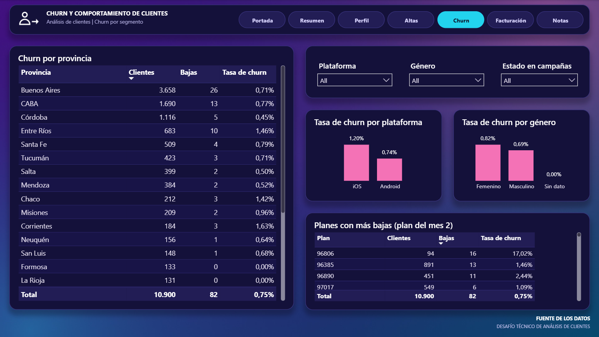
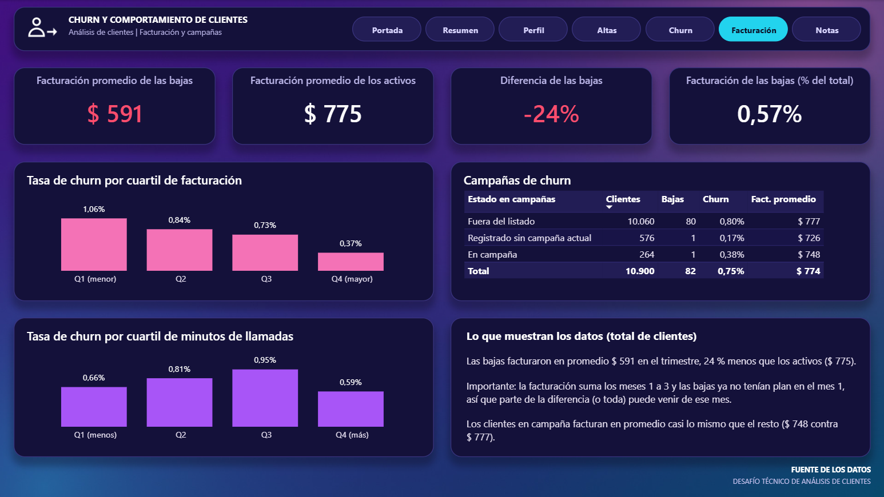
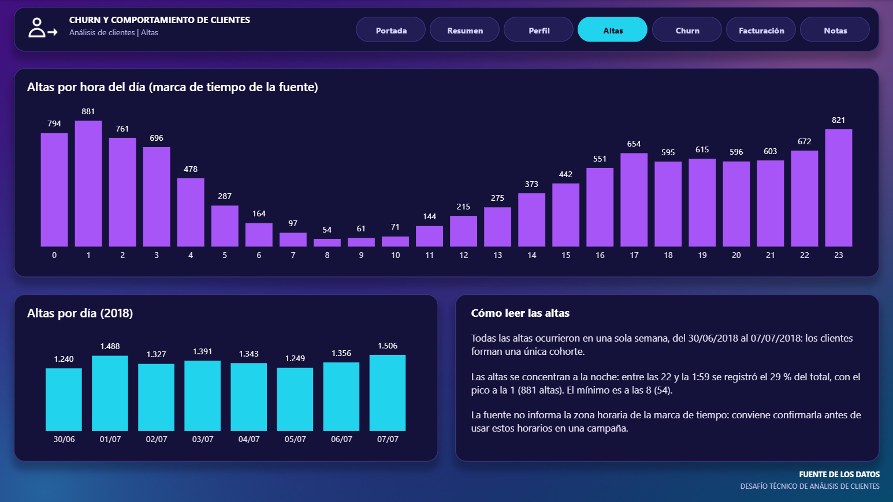
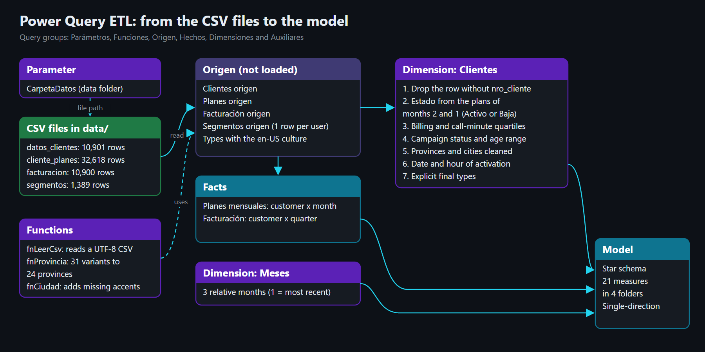
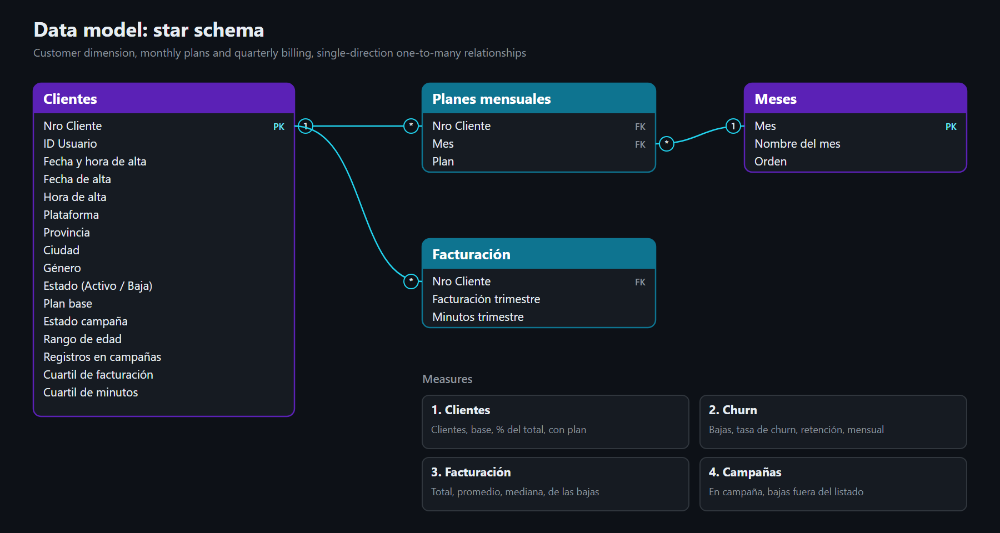

# 📉 Customer Churn & Behavior Analysis (Technical Challenge)

## 📽️ Dashboard Preview
<p align="center">
  
</p>

<p align="center"><a href="docs/Preview.mp4">▶️ Watch the walkthrough in full quality (MP4)</a></p>

> Developed as a technical challenge for a Business Intelligence / Data Analyst position. The dashboard is in Spanish.
> The repository includes the report as a regular **.pbix** file and as a **Power BI Project (PBIP)**, so the data model, the DAX measures and the Power Query code can be read right here on GitHub.

**Stack:**    

## 📋 Executive Summary
An analysis of customer retention for a service with **10,900 customers**: who they are, when they were activated, which plan they had in each month, how much they were billed in the quarter and whether they were part of a churn campaign.

The data comes from four CSV files provided with the challenge (customers, monthly plans, quarterly billing and call minutes, and the churn campaign list) plus a data dictionary.

**How churn is measured.** A customer counts as churned when they had a plan in month 2 and have no plan record in month 1, the most recent month. The churn rate divides churned customers by the customers with a plan in month 2, with the same filters in both terms, so it can be read for any group. The source does not say why a plan record is missing: a churned customer can be a cancellation, a suspension or a missing record.

## 📈 Key Findings

| Indicator | Value |
|---|---:|
| Customers with a plan in month 2 | 10,900 |
| Churned in month 1 | **82** |
| Churn rate | **0.75%** |
| Churned between month 3 and month 2 | 0 |
| Quarterly billing of churned customers | $48,474 (0.57% of $8.44 M) |

- **The churn campaigns missed the customers who left:** 80 of the 82 churned customers (97.6%) were not in the campaign list. Customers in a current campaign are billed about the same on average as customers outside the list ($748 vs. $777).
- **Three plans hold almost half of the churn:** plan 96806 lost 16 of its 94 customers (17%). Together with plans 96385 (13 of 891) and 96890 (11 of 451) it accounts for 49% of churned customers with 13% of the customer base.
- **Lower billing, with a caveat:** churned customers were billed $591 on average in the quarter, 24% less than active customers ($775), and churn falls from 1.06% in the lowest billing quartile to 0.37% in the highest. Billing covers months 1 to 3 and churned customers had no plan in month 1, so part or all of that gap may come from the missing month. Call minutes show no clear pattern.
- **Profile:** Android accounts for 97.7% of customers; women 54.0% and men 45.3%. Buenos Aires province, CABA and Córdoba hold 59% of the base. Differences by platform, gender or province rest on very few cases (for example, 3 churned iOS customers out of 249) and are not conclusive.
- **Activations:** every customer was activated in a single week, from 30 June to 7 July 2018. Activations peak at night: 29% between 22:00 and 01:59, with the maximum at 1:00 (881). The time zone of the timestamp is not documented.

These are observed results for three months of data. The dashboard lists hypotheses to validate (campaign criteria, the three plans, monthly billing), which are not tested here.

## 🖥️ Dashboard Pages

<table>
  <tr>
    <td width="50%"><br><b>Resumen</b>: headline KPIs, customers with a plan by month, churn by plan and by campaign status.</td>
    <td width="50%"><br><b>Perfil de clientes</b>: platform, gender, provinces and cities, with filters by status, campaign status and billing quartile.</td>
  </tr>
  <tr>
    <td width="50%"><br><b>Churn</b>: churn by province (customers, churned and rate), platform, gender and plan.</td>
    <td width="50%"><br><b>Facturación y campañas</b>: billing of churned vs. active customers, churn by billing and call-minute quartile, campaign table.</td>
  </tr>
  <tr>
    <td width="50%"><br><b>Altas</b>: activations by hour of the day and by day.</td>
    <td width="50%">The report also has a cover page with the objective, the data and the churn definition, and a notes page with definitions, data quality notes and hypotheses to validate.</td>
  </tr>
</table>

## 🔄 Data Preparation (Power Query)

<p align="center">
  
</p>

Queries are grouped in folders:

| Folder | Queries | Purpose |
|---|---|---|
| Parámetros | `CarpetaDatos` | Location of the CSV files. Change it after cloning. |
| Funciones | `fnLeerCsv`, `fnProvincia`, `fnCiudad` | Read a UTF-8 CSV; unify province names (31 spellings into 24 provinces); add missing accents to city names. Documented with descriptions and examples. |
| Origen | `Clientes origen`, `Planes origen`, `Facturación origen`, `Segmentos origen` | One query per CSV with explicit types, not loaded. Types use the en-US culture because decimals come with a dot. |
| Hechos | `Planes mensuales`, `Facturación` | Plan per customer and month; quarterly billing and call minutes per customer. |
| Dimensiones | `Clientes`, `Meses` | One row per customer with status, quartiles and campaign data; the three relative months. |
| Auxiliares | `Medidas` | Measures container. |

**`Clientes` step by step**
1. Drop the source row without `nro_cliente` (it cannot be linked to plans or billing).
2. Add the plan of month 2 and the status: `Baja` when there is a plan in month 2 and no plan record in month 1, `Activo` otherwise.
3. Add billing and call-minute quartiles: customers sorted by value and split into four groups of the same size.
4. Add the campaign status and the age range from the campaign list (joined by `user_id`).
5. Clean provinces with `fnProvincia` and cities with `fnCiudad`; translate gender.
6. Add the date and the hour of activation.
7. Set explicit final types for every loaded column.

The status comes from a join with the customers that have a plan in month 1, instead of a row-by-row lookup:

```powerquery
ClientesMes1 = Table.AddColumn(Table.SelectColumns(Table.SelectRows(Planes, each [mes] = 1), {"nro_cliente"}), "Con plan en el mes 1", each true, type logical),
ConMes1 = Table.ExpandTableColumn(Table.NestedJoin(ConPlanBase, {"nro_cliente"}, ClientesMes1, {"nro_cliente"}, "M1", JoinKind.LeftOuter), "M1", {"Con plan en el mes 1"}),
Estado = Table.AddColumn(ConMes1, "Estado", each if [Plan base] = null then "Sin plan en el mes 2" else if [Con plan en el mes 1] = true then "Activo" else "Baja", type text)
```

**Data quality checks**

| Check | Result |
|---|---|
| Customers loaded | 10,900 (one source row without `nro_cliente` left out) |
| Customers with a plan in months 3, 2 and 1 | 10,900, 10,900 and 10,818 |
| Billing rows that match a customer | 10,900 of 10,900 |
| Campaign list users that match a customer | 840 of 1,384 |
| Provinces | 31 spellings unified into 24 |
| `user_id` values | Some arrive damaged by a spreadsheet (lost leading zeros, scientific notation such as `4.11E+08`); two customers share one damaged value |

## 🏗️ Data Model
Star schema: the `Clientes` dimension filters the two fact tables, and `Meses` filters the monthly plans. All relationships are one-to-many with single-direction filters.

<p align="center">
  
</p>

### Measures

| Folder | Measures |
|---|---|
| 1. Clientes | `Clientes`, `Clientes base`, `% del total de clientes`, `Clientes con plan` |
| 2. Churn | `Bajas`, `Tasa de churn`, `Tasa de retención`, `Bajas en el mes`, `Tasa de churn mensual` |
| 3. Facturación | `Facturación`, `Facturación promedio`, `Facturación mediana`, `Minutos promedio`, `Facturación de las bajas`, `% de la facturación en bajas`, `Facturación promedio de las bajas`, `Facturación promedio de los activos`, `Diferencia de facturación de las bajas` |
| 4. Campañas | `Clientes en campaña`, `Bajas fuera del listado`, `% de bajas fuera del listado` |

Numerator and denominator share the same filter context, so the rate is correct for any province, platform, plan or campaign group, and a group with customers but no churn shows 0% instead of a blank:

```dax
Clientes base = CALCULATE ( [Clientes], Clientes[Estado] IN { "Activo", "Baja" } )

Bajas =
IF ( NOT ISBLANK ( [Clientes base] ), CALCULATE ( [Clientes], Clientes[Estado] = "Baja" ) + 0 )

Tasa de churn = DIVIDE ( [Bajas], [Clientes base] )
```

Every table, column, measure and Power Query step can be reviewed in [`Churn_Clientes.SemanticModel/definition`](Churn_Clientes.SemanticModel/definition) (TMDL format).

## ⚠️ Scope and Limitations
- **Three relative months:** the plans have no calendar dates and month 1 is the most recent. One drop between two months cannot show a trend.
- **What a churned customer is:** a missing plan record. The data does not say whether it is a cancellation, a suspension or a missing record.
- **Quarterly billing:** billing and call minutes are totals for months 1 to 3, so they include a month without a plan for churned customers.
- **Small groups:** rates for groups with few customers are unstable (Tierra del Fuego: 2 churned out of 47). Read them together with the number of churned customers.

## 📂 Repository Structure

```
├── Churn_Clientes.pbix                        # the dashboard in a single file, data included
├── Churn_Clientes.pbip                        # the same dashboard as a Power BI Project (source code)
├── Churn_Clientes.SemanticModel/definition/   # data model as code (TMDL): tables, measures, Power Query
├── Churn_Clientes.Report/definition/          # report as code (PBIR): one folder per page and visual
├── data/                                      # source CSV files and the data dictionary
├── Preview.gif                                # dashboard walkthrough (embedded above)
├── docs/Preview.mp4                           # walkthrough in full quality
├── docs/img/                                  # README images: pages, ETL flow and data model
└── LICENSE
```

## ▶️ How to Open It

| | `Churn_Clientes.pbix` | `Churn_Clientes.pbip` |
|---|---|---|
| What it is | A single Power BI file | A Power BI Project: the model (TMDL) and the report (PBIR) as text files |
| Data | Included, ready to explore | Loaded from the CSV files in `/data` when you refresh |
| Best for | Opening the dashboard right away | Reviewing the DAX and Power Query code, version control |

**Option 1: just look at it.** Download `Churn_Clientes.pbix` and open it with Power BI Desktop.

**Option 2: work with the source.**
1. Clone the repository (or download it as a ZIP).
2. Open `Churn_Clientes.pbip` with a recent version of Power BI Desktop.
3. Go to **Home > Transform data > Edit parameters** and set `CarpetaDatos` to the full path of the `data` folder on your computer (ending with `\`).
4. Click **Refresh**.

Both files contain the same report.

## 👤 Author
**Mauro Martínez**. The data was provided with the technical challenge.

The project files are released under the [MIT License](LICENSE). The data remains subject to the terms of its source.
